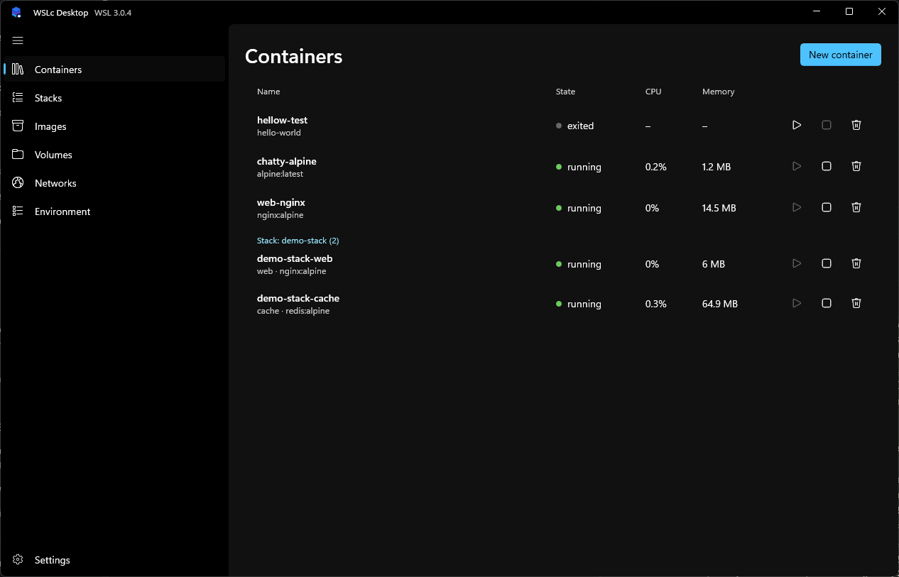

# WSLc Desktop Manager

<p align="center"></p>

WSLc Desktop Manager is a native Windows app for managing [WSLc](https://wsl.dev/) containers. If you're used to Docker Desktop, the workflow should feel familiar: pick an image, create a container, and check its logs when something goes wrong.

The app is built around what WSLc actually supports. You can manage a Compose stack from the UI, for example, but you'll see warnings for settings the runtime can't apply. We think knowing what will run matters more than making every Compose file look supported.

[Documentation](https://seiggy.github.io/wslc-desktop/) · [Downloads](https://github.com/seiggy/wslc-desktop/releases) · [Report an issue](https://github.com/seiggy/wslc-desktop/issues)



## What you can do

| Area | Available in the app |
| --- | --- |
| Containers | Create containers with port mappings and bind mounts. Set environment variables, choose a network, or override the image's command. Start, stop, and delete containers from the list. |
| Troubleshooting | Follow logs with timestamps, run commands in the built-in shell, or inspect a container's configuration and raw JSON. Live charts show CPU and memory use alongside network and disk I/O. |
| Stacks | Open a Compose file, review the execution plan and compatibility warnings, then bring the stack up or down. |
| Images | Pull from public or private registries. Inspect image configuration and layer digests, see which containers use an image, and delete images you no longer need. |
| Volumes and networks | Inspect resources and their attached containers. Remove individual resources or prune unused ones. Attach and detach networks from a container's Inspect tab. |
| Environment and settings | View WSL versions and sessions. Choose light, dark, or Windows-default appearance and a custom accent. Configure the app's CPU and memory limits, enable GPU access, or sign in to a registry. |

The [feature walkthroughs](https://seiggy.github.io/wslc-desktop/features/containers) cover each page with screenshots.

## Get started

### Requirements

- **Windows 11** with WSL and container support.
- **`wslc.exe` on your `PATH`.** Run `wslc --help` in a terminal to check that it's available.

WSLc Desktop Manager needs the WSLc runtime to manage containers. Installing the desktop app alone doesn't replace that requirement.

### Install

Download a build for your machine from [Releases](https://github.com/seiggy/wslc-desktop/releases). Both x64 and ARM64 artifacts are produced by the release workflow.

| Format | How to use it |
| --- | --- |
| Portable EXE | Run the single `WslcDesktop-<version>-win-<architecture>-portable.exe`. Includes .NET, WinUI, and app assets; no installer or companion files. Runtime files are extracted to a per-user cache on launch. |
| MSIX or app bundle | Unsigned Microsoft Store submission files, not direct installers. Install through the Microsoft Store once the listing is live, or use the portable EXE. |

Microsoft signs the Store-distributed packages after certification; GitHub releases no longer generate test-signing certificates or sideload installers. Portable refers to app distribution: settings and container data still live under `%LOCALAPPDATA%`, and WSLc is still required. See [Releasing](RELEASING.md) for Store submission and packaging details. If a release build isn't available, [build from source](#build-from-source).

### First run

Launch **WSLc Desktop Manager**. If the app reports missing WSLc components, choose **Install components**, let installation finish, then choose **Retry**. Once connected, the app opens the Containers page.

From there, pull an image on **Images**, or choose **New container** on **Containers** and enter an image reference. For a multi-service project, open your Compose file from **Stacks** and review the plan before choosing **Up**.

### Your app containers use a separate session

WSLc Desktop Manager creates or reconnects to a session named `WslcDesktop`. The `wslc` CLI's default session is separate, so containers created there won't appear in the app.

And you can still use the CLI with the app's containers. Specify the session explicitly:

```powershell
wslc --session WslcDesktop list --all
wslc --session WslcDesktop image list
```

Closing the app leaves its session and containers running. Reopening it reconnects to that session.

## Compose support and limits

The app parses Compose files and translates them into `wslc` commands. It supports common service settings, including image builds, environment files, and resource limits. Named volumes and networks are supported, and services start in dependency order with health checks where configured.

Review the preview before running a stack. WSLc doesn't support every Compose feature:

- `restart` policies aren't applied, so containers won't automatically restart.
- `deploy` and `scale` don't create replicas; one container starts per service.
- `profiles` are ignored, so those services still start.
- `secrets` and `configs` aren't mounted.
- `extends`, top-level `include`, and platform selection aren't supported.

Unsupported keys produce warnings. Errors such as dependency cycles or a missing required environment file block **Up** until they're fixed.

The [Compose guide](https://seiggy.github.io/wslc-desktop/compose) has the supported-key list and a [sample stack](docs/public/examples/demo-stack/compose.yaml).

The built-in container shell also has a limit: it runs without a TTY. Use it for line-oriented commands; full-screen programs such as `vim` and `top` aren't supported.

## Build from source

You'll need a Windows development machine and the **.NET 10 SDK or a newer SDK that can build .NET 10 projects**. The app targets .NET 10 with WinUI 3 and the Windows App SDK. CI currently uses a .NET 11 preview SDK. Running the app still requires WSLc.

From the repository root, restore using the public NuGet configuration, then build:

```powershell
dotnet restore src\WslcDesktop -p:Platform=x64 -r win-x64 --configfile .github\nuget.ci.config
dotnet build src\WslcDesktop -p:Platform=x64 -r win-x64 --no-restore
```

The repository's default `nuget.config` points to an internal feed. The explicit configuration above uses nuget.org, matching CI.

Run the resulting `WslcDesktop.exe` from:

```text
src\WslcDesktop\bin\x64\Debug\net10.0-windows10.0.26100.0\win-x64\
```

For an ARM64 build, use `-p:Platform=ARM64 -r win-arm64` in both commands. Close any running instance before launching a development build.

### Tests

The test projects cover the Compose parser and planner, plus UI-independent app logic. Restore them with the same public feed configuration:

```powershell
dotnet restore tests\WslcDesktop.Compose.Tests --configfile .github\nuget.ci.config
dotnet restore tests\WslcDesktop.Tests --configfile .github\nuget.ci.config
dotnet test tests\WslcDesktop.Compose.Tests --no-restore
dotnet test tests\WslcDesktop.Tests --no-restore
```

## How it's put together

The WinUI 3 app uses the [`Microsoft.WSL.Containers`](https://wsl.dev/api-reference/csharp/) API alongside `wslc.exe`. The API can't enumerate containers or sessions, so discovery goes through the CLI. The CLI also handles Compose execution and workflows such as log streaming and the container shell.

| Location | Contents |
| --- | --- |
| `src\WslcDesktop` | Windows app, including views and WSLc integration services. |
| `src\WslcDesktop.Compose` | Compose parsing, execution planning, and the runner. |
| `tests` | xUnit test projects. |
| `docs` | VitePress documentation and screenshots. |
| `tools` | Packaging scripts and icon tooling. |
| `assets\branding` | Logos and branding assets. |

App preferences live in `%LOCALAPPDATA%\WslcDesktop\settings.json`. WSLc's default-session configuration lives in `%LOCALAPPDATA%\wslc\settings.yaml`; it doesn't configure the app's separate session. Registry credentials are passed to WSLc's credential store. The app remembers registry server names, not passwords or tokens.

## Documentation and contributing

Start with [Getting started](https://seiggy.github.io/wslc-desktop/getting-started) for setup, or [Troubleshooting](https://seiggy.github.io/wslc-desktop/troubleshooting) if the session won't start or a container isn't visible.

Bug reports and pull requests are welcome. When reporting a problem, include your WSL version and the exact error text, with credentials and other sensitive details removed. Open pull requests against `main`; the [contributing guide](docs/contributing.md) explains the documentation workflow. Release maintainers can follow [Releasing](RELEASING.md).

## License

[MIT](LICENSE).
